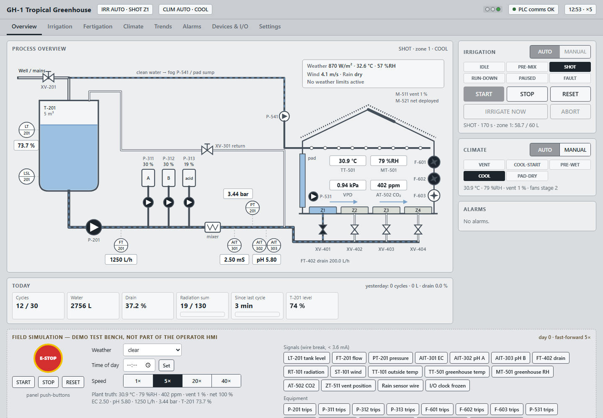
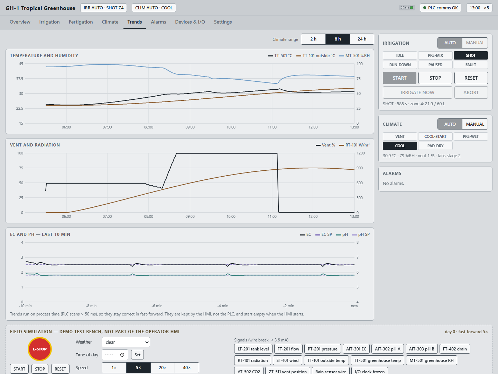

# GH-1 Tropical Greenhouse — PLC control system

[](../../actions/workflows/ci.yml)

A PLC project for a 1 000 m² tropical lowland greenhouse:
- **drip irrigation** in four zones;
- **fertigation**: inline A/B nutrient and acid dosing on EC and pH;
- **climate control**: roof vents, shade net, fogging, and pad-and-fan cooling with weather overrides.

The program is **IEC 61131-3 Structured Text** for **OpenPLC v4**, integrated over **Modbus TCP**. A virtual plant replaces the hardware, so the whole system runs and is tested on a laptop. The plant models the weather, greenhouse air, crop, hydraulics and water chemistry. An **ISA-101 style web HMI** shows it running. **102 automated tests** cover the project: 83 factory-acceptance tests check every functional, safety, diagnostic and HMI requirement, and 19 more test the Structured Text interpreter. The program also runs on **OpenPLC Runtime v4**, where FAT part B passes 7/7.



> **Status: phase 4 of 5 done.** In place: the PLC program, plant model, soft-PLC with fast-forward, web HMI and automated FAT. The program compiles clean with STruC++ (the OpenPLC v4 compiler) and runs on OpenPLC Runtime v4, where FAT part B passes 7/7 ([docs/openplc.md](docs/openplc.md)). Next, phase 5 adds electrical drawings, I/O checkout, a commissioning procedure, a troubleshooting trainer and a report. See [docs/SCOPE.md](docs/SCOPE.md).

## What it does
- **Irrigation**: cycles start on accumulated solar radiation, or after a maximum interval, inside a day window. Each cycle first pre-mixes the nutrient solution through a return loop until EC and pH are in band. It then waters the zones one by one, metered by a flow transmitter, with open-before-close changeover.
- **Fertigation**: ratio control with feedback trim. Dosing is proportional to the measured water flow and corrected by PI loops with an integration zone. Duplicated pH probes are cross-checked, with a fallback if one fails.
- **Climate**: a state machine runs VENT → COOL-START → PRE-WET → COOL → PAD-DRY. The vents follow the larger of a temperature demand and a humidity demand, limited by rain, wind and storm. Pad-and-fan cooling runs only with the vents closed.
- **Protection**, each with a defined fallback:
  - E-stop;
  - pump dry-run, dead-head and pressure limits;
  - crop-protection limits on EC and pH;
  - actuator travel supervision;
  - motor feedback lock-outs;
  - NAMUR NE 43 signal-fault detection.

Every pump, valve and fan is an instance of a standard device block (`FB_Motor`, `FB_Valve`, `FB_Actuator`). The PLC publishes **why** a device is held off, for example *"F-601 blocked: Vents not closed"*. It also counts starts, running minutes, valve cycles and vent reversals for maintenance.

**One simulated clear day** (05:00–19:00, outside air up to 33 °C, default settings):

| Greenhouse max | Cooling | Irrigation | Water | Drain | EC / pH while watering | Alarms |
|---|---|---|---|---|---|---|
| 32.4 °C (limit 35) | 1 VENT → COOL → VENT round trip | 18 cycles, first at 06:30 | 4.4 m³ | 43.8 % | 2.48–2.50 mS/cm / 5.79–5.82 | none |

## Quick start
Requires Python 3.10+. Nothing else is needed at runtime.

```bash
git clone https://github.com/rayangmendrofa/horticulture-farm-plc.git && cd horticulture-farm-plc
python -m farmsim                       # PLC + plant at 20x real time, HMI opens on http://127.0.0.1:8080
python -m farmsim fast --clock 10:30    # start mid-morning (any HH:MM)
python -m farmsim live                  # plant and soft-PLC over separate Modbus TCP links, real time
```
At 20× a day takes 72 minutes. Use the **Field simulation** panel at the bottom of the page for these:
- change the weather (clear, cloudy, rain, storm);
- jump the clock;
- change the speed (1–40×);
- press the E-stop;
- inject one of 41 field faults (wire breaks, pump trips, a jammed vent, a clogged zone, empty stock tanks…) and watch the PLC react.

## The HMI
| Page | Shows |
|---|---|
| **Overview** | Mimic of the water system and greenhouse: tank, pump, dosing skid, analysers, zones, vent, shade net, fog, pad and fans. Weather strip and today's counters |
| **Irrigation** | Step chain, zone volume, radiation sum against the start threshold, zone table with flow diagnostics, daily totals, manual control |
| **Fertigation** | EC and pH against their bands, pH A/B deviation, dosing outputs, stock tanks, why dosing is not permitted, 10-minute trend |
| **Climate** | State chain, inside climate and VPD, weather and the limits it imposes, vent positioner, manual control |
| **Trends** | Temperature, humidity, vent and radiation over 2, 8 or 24 h; EC and pH over 10 min |
| **Alarms** | Active and cleared-but-not-reset alarms with class (trip, lock-out, alarm, warning) |
| **Devices & I/O** | Every device's state, interlock reasons and maintenance counters; all I/O points |
| **Settings** | All 27 setpoints with limits, download to the PLC, and the value the PLC actually holds |

A command button is enabled only when the PLC would accept it. Normal states are grey; colour means something is wrong. If the PLC heartbeat stops, the page dims. Trends run on PLC scan time, so they stay correct in fast-forward.



## Run the tests
```bash
pip install -e ".[dev]"
pytest -v                               # automated FAT, about 3 min
pytest -v --runslow                     # plus one full simulated day, about 10 min more
FARMSIM_STRICT=1 pytest -v              # the same FAT on the strict VM (run-time IEC type checks)
python tools/check_openplc_compile.py   # STruC++ compile check (FAT OPL-01)
python tools/simulate_day.py            # hourly summary of a simulated day
```
CI does three things:
- runs the FAT on Ubuntu and Windows with Python 3.10 and 3.12;
- runs it again on the strict VM, together with the full day;
- compiles the program with STruC++.

## Architecture
```
 ┌────────────────┐  Modbus TCP   ┌───────────────────────────┐  Modbus TCP    ┌──────────┐
 │ Virtual plant  │◄─────────────►│ PLC: greenhouse.st        │◄──────────────►│ Web HMI  │
 │ remote I/O     │   :5020       │ soft-PLC  ─or─  OpenPLC   │ :5502 / :502   │ :8080    │
 │ + I/O clock    │               │ %IX/%IW100… %QX/%QW100…   │ %MW0–139       │          │
 └────────────────┘               └───────────────────────────┘                └──────────┘
```
The soft-PLC runs the **same** `.st` file that OpenPLC compiles, with OpenPLC's Modbus address map. The plant and HMI therefore work unchanged against a real OpenPLC runtime:

```bash
python -m farmsim hmi --plc <ip>:502 --plant none
```

**On OpenPLC Runtime v4** (Docker on WSL2), the program has passed FAT part B, 7/7. The tests drive the runtime only through its Modbus server, with the plant as its remote I/O:
- **E-stop:** field outputs off 98 ms after the input opened.
- **Plant loss:** a lost plant link trips the PLC in 0.06 s.
- **Irrigation:** a full cycle with EC and pH in band while watering.
- **Vent:** positioned to within 0.4 %.

[docs/openplc.md](docs/openplc.md) has the build and upload route and the results:
- `tools/make_openplc_project.py` generates the Editor project;
- `tools/openplc_runtime.ps1` uploads it (you type the login);
- `tools/fat_openplc.py` runs the tests.

In fast-forward the PLC VM and the plant advance together in virtual time (50 ms scans). Every timer, PI loop and timeout therefore behaves exactly as at 1×.

## Repository
| Path | Contents |
|---|---|
| [`plc/greenhouse.st`](plc/greenhouse.st) | **The PLC program**: `FB_AnalogIn`, `FB_PIControl`, `FB_Motor`, `FB_Valve`, `FB_Actuator`, `PROGRAM Greenhouse`, task configuration |
| `farmsim/plant.py`, `weather.py` | Process model: weather day cycle, greenhouse heat/vapour/CO₂ balance, crop transpiration, pump and dripper hydraulics, carbonate pH chemistry with mixing and dead time, actuators, fault injection |
| `farmsim/plant_server.py` | The plant as a Modbus TCP remote-I/O device, with a 1 s output watchdog |
| `farmsim/softplc.py` | OpenPLC-compatible runtime (50 ms task, Modbus server and remote-I/O master) and the fast-forward runner |
| `farmsim/hmi.py`, `farmsim/web/` | Web HMI: Modbus client, JSON API, single-page operator UI |
| `farmsim/tags.py` | The PLC ↔ HMI register map, single source of truth |
| `farmsim/stvm.py`, `modbus.py` | IEC 61131-3 Structured Text interpreter (strict and lean modes), and Modbus TCP server and client (standard library) |
| `farmsim/bench.py`, `tests/` | Test bench and the automated FAT |
| `tools/` | STruC++ compile check, OpenPLC Editor project generator, upload script, FAT part B runner, day simulation, dosing-loop tuning sweep |

## Documentation
| Document | For |
|---|---|
| [Scope](docs/SCOPE.md) | What was agreed, and what is out of scope |
| [PRD](docs/PRD.md) | Requirements, each traced to an automated test |
| [FDS](docs/FDS.md) | I/O list, sequences, control loops, cause & effect, alarms, register map, HMI |
| [OpenPLC](docs/openplc.md) | Running on OpenPLC Runtime v4: build, upload, Modbus configuration, FAT part B results |
| [Credits](CREDITS.md) | Software, standards and references this project builds on |

## Licence
[MIT](LICENSE). Third-party software and references are listed in [CREDITS.md](CREDITS.md).

## Safety note
This is an engineering demonstration. The PLC's E-stop handling is a monitoring layer only. Real equipment needs a hardwired, certified safety circuit and a risk assessment. Modbus TCP has no authentication, so keep it on an isolated network.
